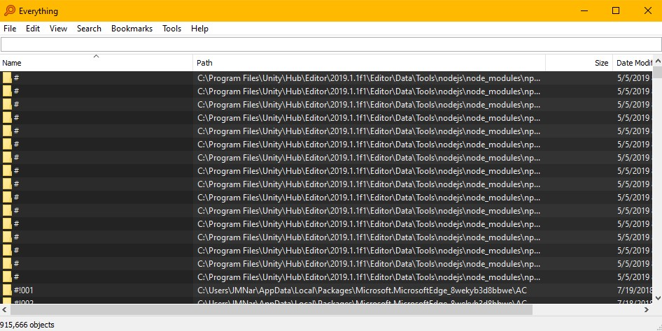
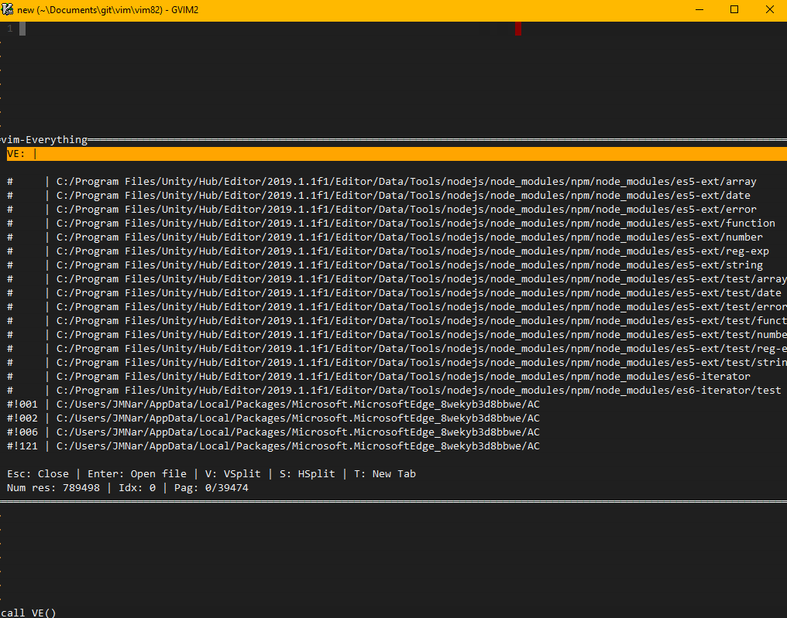
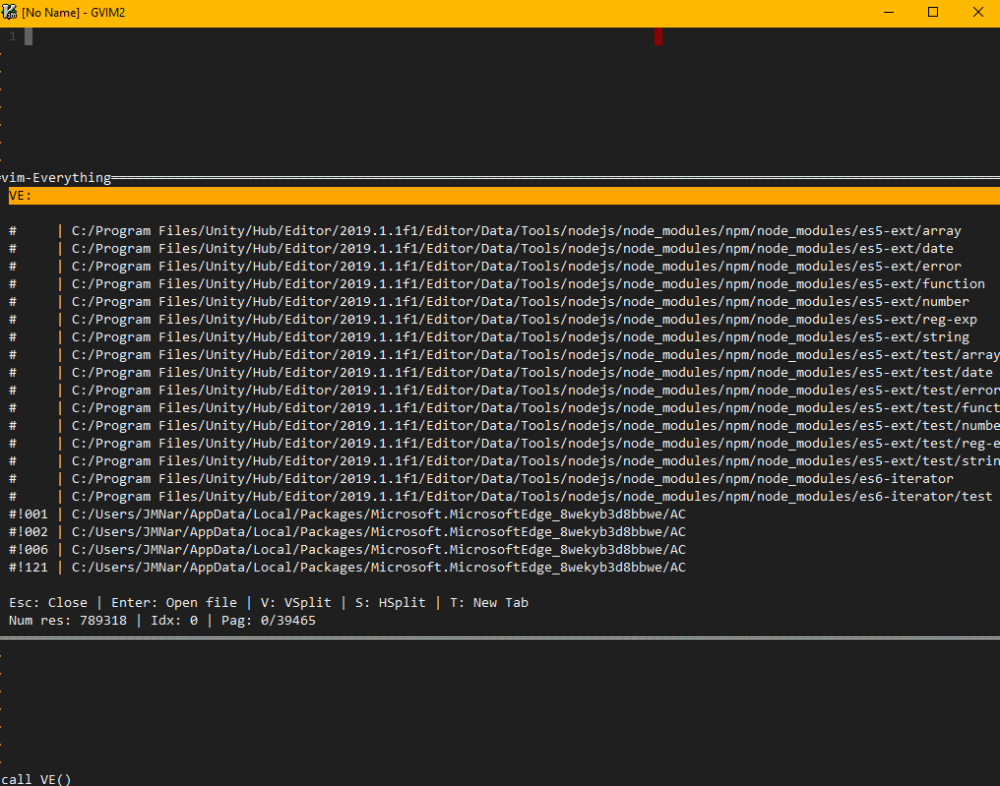

# vim-everything

## What is it?
VE is a small wrapper for the black magic tool: [Everything](https://www.voidtools.com/)



On platforms without Everything, VE can fall back to
[fd](https://github.com/sharkdp/fd) or [ripgrep](https://github.com/BurntSushi/ripgrep)
for project-scoped searching.

## Installation and Requirements

**Requires Python and a version of Vim compiled with Python support.**

**Requires Everything to be running in the background.**

The plugin makes use of Vim's popup windows from Vim 8.2+.

Install with your favorite plugin manager:

```vim
" vim-plug
Plug 'Aborres/vim-everything'

" Vundle
Plugin 'Aborres/vim-everything'

```

Or with Vim's built-in package support:

```
git clone https://github.com/Aborres/vim-everything ~/.vim/pack/plugins/start/vim-everything
```

(On Windows: `%USERPROFILE%\vimfiles\pack\plugins\start\`.)

After installing, regenerate help tags (`:helptags ALL`) and see the full reference with:

```vim
:help vim-everything
```

## Usage

VE doesn't bind any keys by default. Map the entry point to whatever you like, for example:

```vim
nnoremap <C-p> :call VE()<CR>
```

Available entry points:

```vim
VE()                          " open VE (restores previous search if enabled)
VE_Path()                     " search input text, keeping the previous path
VE_Search(txt)                " search the given text
VE_SearchInPath(path)         " open VE scoped to the given path
VE_SearchFileInPath(file, path)
```

Use **Enter/Esc** to move between the search bar and the results.
**Esc** from the search bar closes VE.



### Search

VE accepts the same query syntax Everything accepts, for example:
`*.vim \vim\` lists all `.vim` files under any `\vim\` hierarchy. 
See [Everything's search reference](https://www.voidtools.com/support/everything/searching/) for filters and advanced syntax.

Filter by result type with the `file_results` option or inline prefixes:
`a:` (all), `f:` (files), `d:` (directories), , for example `f:texture.cpp \my_engine\`.

Shortcuts while editing the query (all customizable via `g:ve.shortcuts`):

| Key | Action |
|-----|--------|
| `` ` `` | Clear the whole search |
| `!` | Clear the name part |
| `@` | Clear the path part |
| `#` | Clear the extension part |
| `%` | Clear the type filter |
| `;` | Remove the last folder from the path |
| `?` | Open the query history window |

### Results

Standard Vim navigation:

- `j`/`k` (or arrows) — move between results
- `h`/`l` — jump between result pages
- `g`/`G` — first/last result
- Number/letter jump shortcuts (`1`–`0`, `q`–`p` by default) open a result directly, when `enable_number_jump` is on

Opening results:

| Key | File action | Folder action |
|-----|-------------|---------------|
| `Enter` | `:edit` | `:Explore` (netrw) |
| `V` | `:vsplit` | `:Vexplore` |
| `S` | `:split` | `:Hexplore` |
| `T` | `:tabe` | `:Texplore` |

All actions are customizable via `g:ve.actions`.



Results can optionally show file size and last modification date (`results_size`, `results_mod_date`).

## Configuration

vim-everything configuration lives in: `g:ve`. 
The complete reference for every option is in `:help vim-everything-variables`.

```vim
" Core behavior
let g:ve.config = #{
  \ list_size: 20,              " minimum number of results to show
  \ enable_number_jump: 1,      " quick-open shortcuts in the results list
  \ keep_prev_search: 1,        " keep input text between searches
  \ use_python3: 1,             " 0 to use python27
  \ file_results: 1,            " 0: all, 1: files, 2: folders
  \ results_size: 1,            " show file sizes
  \ results_mod_date: 1,        " show modification dates
  \ switch_focus: 1,            " jump to existing buffer if already open
  \ use_alternative_search: 0,  " enable the fd/rg fallback backend
  \ alternative_search_mode: 0, " 0: fd, 1: rg
\ }

" Open actions (files and folders)
let g:ve.actions = #{
  \ edit:     'edit',
  \ vedit:    'vsplit',
  \ hedit:    'split',
  \ tedit:    'tabe',
  \ explore:  'Explore',
  \ vexplore: 'Vexplore',
  \ hexplore: 'Hexplore',
  \ texplore: 'Texplore',
\ }

" Query cache (stores recent queries, not results)
let g:ve.history = #{
  \ enabled: 1,
  \ pool_size: 10,
\ }
```

### Styling

Edit `g:ve.style` to cutomize popup window style:

```vim
let g:ve.style = #{
  \ window: #{
    \ style: '',                " highlight group for the window
    \ selection: 'VESelected',  " highlight group for the selection bar
    \ fixed_w: 128,             " fixed width (0 = automatic)
    \ fixed_h: 1,
    \ resize: 1,
    \ wrap: 0,
    \ border: #{
      \ icons: ['─', '│', '─', '│', '╭', '╮', '╯', '╰'],
      \ style: [],
    \ },
    \ scrollbar: #{ enabled: 0, style: '', thumb_style: '' },
  \ },
  \ cursor: #{ blink: 500, icon: '|' },
  \ footer: #{ style: 0 },     " 0: all, 1: simplified, 2: stats only
\ }
```

Style changes after the first open can be applied with:
`:call VE_Refresh()`

### Extending with callbacks

Custom actions can be attached to keys in the results list:

```vim
func! MyCallback(id, file)
  " id: VE's popup window, file: the highlighted result
endfunc

call VE_AddCallback(['x', 'MyAction', function('MyCallback')])
```

See `:help g:ve.callbacks` for details.

## Alternative backends (fd / ripgrep)

Everything is the default, maintained, and recommended backend. 
For platforms where Everything isn't available or by choice on Windows, VE can search with fd or ripgrep instead:

```vim
let g:ve.config.use_alternative_search = 1
let g:ve.config.alternative_search_mode = 0   " 0: fd, 1: rg
```

Note that the alternative backends walk the filesystem per query rather than using a prebuilt index.
Some Everything-specific features (such as the `file_results` type filter) do not apply to them.

## Documentation

```vim
:help vim-everything
```
